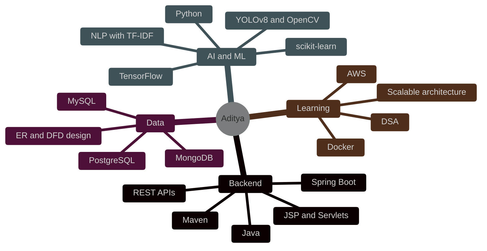
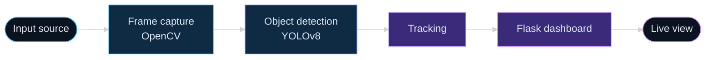
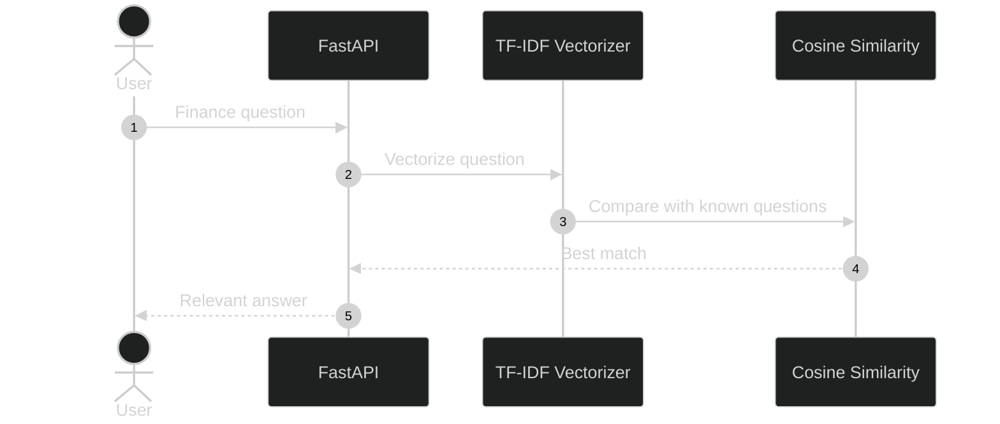
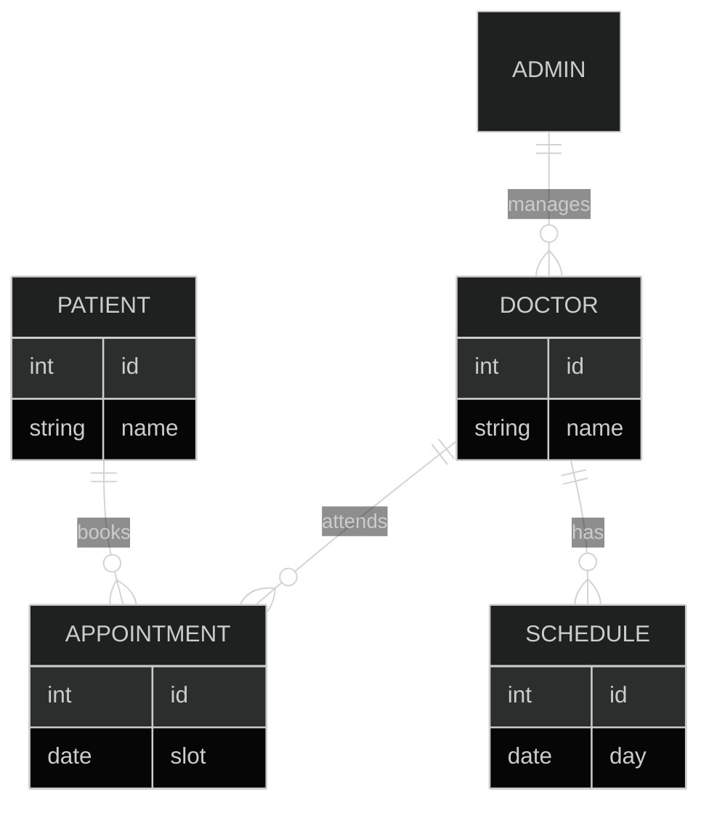
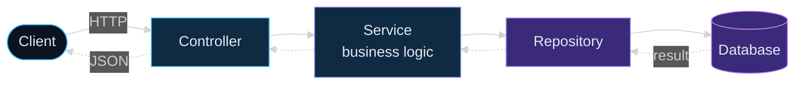
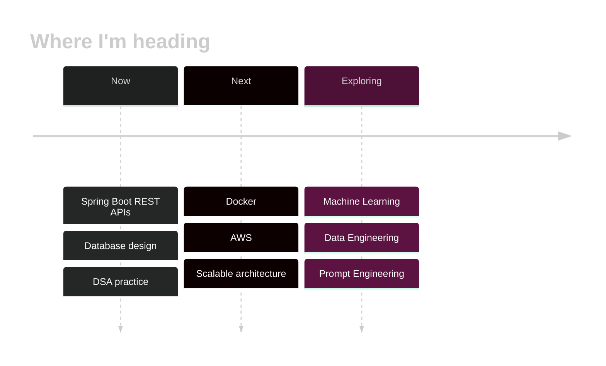

<div align="center">


<a href="https://github.com/Adityanaik1818">
  
</a>

<br/>

<p>
  <a href="#about"></a>
  <a href="#skills"></a>
  <a href="#projects"></a>
  <a href="#architecture"></a>
  <a href="#stats"></a>
  <a href="#contact"></a>
</p>

<p>
  <a href="https://linkedin.com/in/aditya-naik-b42a64284/"></a>
  <a href="mailto:adityanaik756@gmail.com"></a>
  <a href="https://leetcode.com/u/yaEuG6rCPF/"></a>
  <a href="https://github.com/Adityanaik1818"></a>
  
</p>

<p>
  
  
  
</p>

</div>

<br/>

<a name="about"></a>


<table>
<tr>
<td width="52%" valign="top">


```java
public class AdityaNaik {
    String role        = "Java Backend Developer";
    String education   = "MCA, D. Y. Patil International University";
    String location    = "Maharashtra, India";

    String[] building  = {"REST backends", "MVC web apps", "Database designs"};
    String[] exploring = {"Machine Learning", "Data Engineering", "Prompt Engineering"};
    String[] learning  = {"DSA", "Cloud DevOps", "Scalable Architecture"};
}
```

</td>
<td width="48%" valign="top">

#### 🔭 Right now

- 🧱 Building REST backends with **Spring Boot**
- 🗄️ Designing clean **relational databases**
- 🧠 Exploring **ML** with Python and scikit-learn
- 🧮 Sharpening **DSA** on LeetCode
- ☁️ Learning **Docker** and **AWS**

> *I turn complex problems into structured systems.*

</td>
</tr>
</table>

<table>
<tr>
<td width="33%" align="center" valign="top">

### 🧩
**Structured thinking**<br/>
<sub>Start from the problem, break it into clear parts, then build.</sub>

</td>
<td width="33%" align="center" valign="top">

### 🗄️
**Data first**<br/>
<sub>Good ER and data flow design before the first line of code.</sub>

</td>
<td width="33%" align="center" valign="top">

### 🔁
**End-to-end flow**<br/>
<sub>From controller to service to database, I care about the whole path.</sub>

</td>
</tr>
</table>

<a name="skills"></a>


<div align="center">


<sub>Also: JSP/Servlets • Apache • NumPy • Pandas • YOLOv8 • TF-IDF</sub>

</div>

<br/>



<a name="projects"></a>


<table>
<tr>
<td width="50%" valign="top">


<p>Real-time object detection and tracking dashboard with multiple input types. Built for CodeAlpha Task 4.</p>
<p>


</p>
<a href="https://github.com/Adityanaik1818/CodeAlpha_ObjectDetectionTracking"></a>

</td>
<td width="50%" valign="top">


<p>MVC web application managing patient records, doctor schedules, appointments and admin workflows.</p>
<p>


</p>


</td>
</tr>
<tr>
<td width="50%" valign="top">


<p>NLP chatbot that matches finance questions to relevant answers using TF-IDF and cosine similarity.</p>
<p>


</p>


</td>
<td width="50%" valign="top">


<p>Java application for core banking operations and transaction handling, built on OOP principles.</p>
<p>


</p>


</td>
</tr>
<tr>
<td colspan="2" valign="top">


<p>System architecture and database design for a dairy retail platform, with ER and data flow diagrams for inventory and sales.</p>
<p>


</p>

</td>
</tr>
</table>

<a name="architecture"></a>


A closer look at how a few of these projects are put together. These diagrams are simplified.

<details open>
<summary><b>👁️ VisionTrack AI: detection pipeline</b></summary>



</details>

<details open>
<summary><b>🤖 AI Financial Chatbot: question matching</b></summary>



</details>

<details>
<summary><b>🏥 Hospital Management System: data model</b></summary>



</details>

<details>
<summary><b>🧭 How I think about any backend</b></summary>



</details>

### 🗺️ Roadmap



<a name="stats"></a>


<div align="center">
  
  
  <br/>
  
  <br/>
  
  <br/><br/>
  
</div>

<a name="contact"></a>


<div align="center">

### 🤝 Let's build something solid

Interested in my work or have an opportunity in backend development?

<a href="mailto:adityanaik756@gmail.com"></a>
<a href="https://linkedin.com/in/aditya-naik-b42a64284/"></a>
<a href="https://leetcode.com/u/yaEuG6rCPF/"></a>

<br/><br/>


</div>
