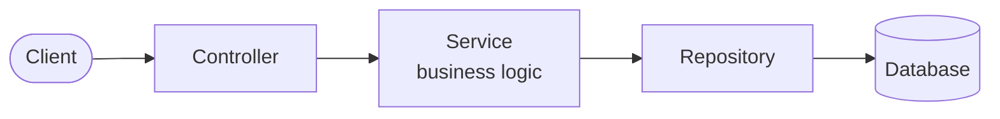

<div align="center">


<p>
  <a href="https://linkedin.com/in/aditya-naik-b42a64284/"></a>
  <a href="mailto:adityanaik756@gmail.com"></a>
  <a href="https://leetcode.com/u/yaEuG6rCPF/"></a>
</p>

</div>

---

## 👨‍💻 About Me

```java
public class AdityaNaik {
    String role        = "Java Backend Developer";
    String education   = "MCA, D. Y. Patil International University";
    String location    = "Maharashtra, India";
    String[] building  = {"REST backends", "MVC web apps", "Database designs"};
    String[] exploring = {"Machine Learning", "Data Engineering", "Prompt Engineering"};
    String[] learning  = {"DSA", "Cloud DevOps", "Scalable Architecture"};
}
```

> I turn complex problems into structured systems: model the data, map the flow, then write the code.

## 🧭 How I Think About a Backend



## 🛠️ Tech Stack

<div align="center">

**Backend and Languages**


**Databases and AI/ML**


**Tools and Currently Learning**


<sub>Also: JSP/Servlets • Apache • Oracle • NumPy • Pandas</sub>

</div>

## 🚀 Featured Projects

<table>
<tr>
<td width="50%" valign="top">

<h3>👁️ VisionTrack AI</h3>
<p>Real-time object detection and tracking dashboard with multiple input types. Built for CodeAlpha Task 4.</p>
<p><code>Python</code> <code>Flask</code> <code>YOLOv8</code> <code>OpenCV</code></p>
<a href="https://github.com/Adityanaik1818/CodeAlpha_ObjectDetectionTracking"></a>

</td>
<td width="50%" valign="top">

<h3>🏥 Hospital Management System</h3>
<p>MVC web application managing patient records, doctor schedules, appointments and admin workflows.</p>
<p><code>Java</code> <code>JSP/Servlets</code> <code>Maven</code> <code>MySQL</code></p>

</td>
</tr>
<tr>
<td width="50%" valign="top">

<h3>🤖 AI Financial Chatbot</h3>
<p>NLP chatbot that matches finance questions to relevant answers using TF-IDF and cosine similarity.</p>
<p><code>Python</code> <code>FastAPI</code> <code>scikit-learn</code></p>

</td>
<td width="50%" valign="top">

<h3>🏦 Bank Management System</h3>
<p>Java application for core banking operations and transaction handling, built on OOP principles.</p>
<p><code>Java</code> <code>OOP</code> <code>MySQL</code></p>

</td>
</tr>
<tr>
<td colspan="2" valign="top">

<h3>🥛 Milk Product Shop Management</h3>
<p>System architecture and database design for a dairy retail platform, with ER and data flow diagrams for inventory and sales.</p>
<p><code>System Design</code> <code>ERD</code> <code>DFD</code> <code>SQL</code></p>

</td>
</tr>
</table>

## 📊 GitHub Analytics

<div align="center">
  
  
  <br />
  
</div>

---

<div align="center">

### 🤝 Let's Connect

Interested in my work or have an opportunity in backend development?

<a href="mailto:adityanaik756@gmail.com"></a>


</div>
